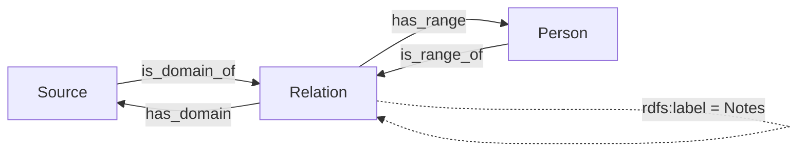

Metapolis links its entities (Building, Event, Person, Source) through a **bidirectional relation system**. This page explains how relations are stored, how the forms create them, and how to modify or extend them.

**See also:** [Data Model and Forms](Data-Model-and-Forms)

## Contents

- [Core concepts](#core-concepts)
  - [Relations are entities](#relations-are-entities)
  - [Domain and range](#domain-and-range)
  - [Bidirectionality](#bidirectionality)
- [Relation architecture](#relation-architecture)
- [The Knowledge Patterns](#the-knowledge-patterns)
  - [On the entity: `entity_is_domain_of_relation_X` (outgoing)](#on-the-entity-entity_is_domain_of_relation_x-outgoing)
  - [On the entity: `entity_is_range_of_relation_X` (incoming)](#on-the-entity-entity_is_range_of_relation_x-incoming)
  - [On the relation: `relation_has_range_X` and `relation_has_domain_X`](#on-the-relation-relation_has_range_x-and-relation_has_domain_x)
- [How the forms use them](#how-the-forms-use-them)
- [Example: a Source related to a Person](#example-a-source-related-to-a-person)
- [Modifying relations](#modifying-relations)
  - [Adding a property to relations](#adding-a-property-to-relations)
  - [Adding a new entity type to relations](#adding-a-new-entity-type-to-relations)
- [Best practices](#best-practices)
- [Troubleshooting](#troubleshooting)

---

## Core concepts

### Relations are entities

A relation is not a simple link between two entities: it is a **first-class resource** with its own properties:

- **Type**: `http://metapolis.com#Relation` (`metapolis_ontology:Relation`)
- **IRI**: `https://metapolis.com/resource/relation/{UUID}`
- **Notes**: free text about the relation, stored as `rdfs:label`
- **Domain**: the entity the relation starts from
- **Range**: the entity the relation points to

Because the relation is independent of the entities it connects, it can carry notes (and, in the future, a type, dates or a source).

### Domain and range

| Property | From → To | Meaning |
|---|---|---|
| `metapolis_ontology:has_domain` | Relation → entity | The entity the relation starts from |
| `metapolis_ontology:has_range` | Relation → entity | The entity the relation points to |
| `metapolis_ontology:is_domain_of` | entity → Relation | Inverse of `has_domain` |
| `metapolis_ontology:is_range_of` | entity → Relation | Inverse of `has_range` |

### Bidirectionality

Every insert pattern writes **both** a property and its inverse. When a relation from entity A to entity B is created, A is linked to the relation with `is_domain_of`, the relation to A with `has_domain`, and the same for B with `is_range_of` / `has_range`. The relation is therefore visible and editable from both entities: as an **outgoing** relation in A's form and as an **incoming** relation in B's form.

## Relation architecture



All properties are in the `metapolis_ontology:` namespace (`http://metapolis.com#`).

## The Knowledge Patterns

Relations use four families of Knowledge Patterns (in `Metapolis_KP.trig`, category **Metapolis**), one per target type `X` ∈ {`building`, `event`, `person`, `source`}. The KP's *range* is the class of the entity **at the other end** (`metapolis_ontology:Building`, `Event`, `Person` or `Source`).

### On the entity: `entity_is_domain_of_relation_X` (outgoing)

Used in the form of the entity that starts the relation; lists the relations whose range is an `X`.

```sparql
# insert
INSERT {
  $subject metapolis_ontology:is_domain_of $value.
  $value metapolis_ontology:has_domain $subject.
} WHERE {}

# select
SELECT ?value ?label WHERE {
  $subject metapolis_ontology:is_domain_of $value.
  $value metapolis_ontology:has_range ?range.
  ?range a metapolis_ontology:X.
}

# delete: the same triples as the insert
```

### On the entity: `entity_is_range_of_relation_X` (incoming)

Used in the form of the entity the relation points to; lists the relations whose domain is an `X`.

```sparql
# insert
INSERT {
  $subject metapolis_ontology:is_range_of $value.
  $value metapolis_ontology:has_range $subject.
} WHERE {}

# select
SELECT ?value ?label WHERE {
  $subject metapolis_ontology:is_range_of $value.
  $value metapolis_ontology:has_domain ?domain.
  ?domain a metapolis_ontology:X.
}

# delete: the same triples as the insert
```

### On the relation: `relation_has_range_X` and `relation_has_domain_X`

Used inside the relation itself, to pick the entity at the other end.

```sparql
# relation_has_range_X – insert
INSERT {
  $subject metapolis_ontology:has_range $value.
  $value metapolis_ontology:is_range_of $subject.
} WHERE {}

# relation_has_range_X – select
SELECT ?value ?label WHERE {
  $subject metapolis_ontology:has_range $value.
  $value a metapolis_ontology:X.
}

# relation_has_domain_X – insert
INSERT {
  $subject metapolis_ontology:has_domain $value.
  $value metapolis_ontology:is_domain_of $subject.
} WHERE {}

# relation_has_domain_X – select
SELECT ?value ?label WHERE {
  $subject metapolis_ontology:has_domain $value.
  $value a metapolis_ontology:X.
}
```

The delete patterns remove the same triples as the corresponding insert, so both directions are cleaned up when a relation or one of its ends is removed.

Here `$subject` is the entity (for `entity_*` KPs) or the relation (for `relation_*` KPs), and `$value` is the other resource.

## How the forms use them

Each entity form declares the KPs in its `fieldDefinitions` and has a tab for each of the other three entity types (Building: Events, People, Sources; Event: Buildings, People, Sources; and so on). Each tab contains two composite inputs:

| Section | Field on the entity | Field inside the relation |
|---|---|---|
| **Outgoing relations** | `entity_is_domain_of_relation_X` | `relation_has_range_X` |
| **Incoming relations** | `entity_is_range_of_relation_X` | `relation_has_domain_X` |

For example, the **Incoming relation** from a Source in the Person form:

```html
<semantic-form-composite-input
  label="Incoming relation"
  for="entity_is_range_of_relation_source"
  new-subject-template="https://metapolis.com/resource/relation/{{{{raw}}}}{{UUID}}{{{{/raw}}}}"
  parent-subject="{{subject}}"
  fields='[[ fieldDefinitions
    type                       = "http://www.w3.org/2000/01/rdf-schema#type"
    has_label                  = "http://www.w3.org/2000/01/rdf-schema#label"
    relation_has_domain_source = "http://www.researchspace.org/pattern/relation_has_domain_source"
  ]]'>

  <semantic-form-hidden-input for="type" default-value='http://metapolis.com#Relation'></semantic-form-hidden-input>

  <semantic-form-drag-and-drop-input
    for='relation_has_domain_source'
    nested-form-template='{{{{raw}}}}{{> metapolis_forms:Source nested=true editable=true mode="new" }}{{{{/raw}}}}'
    label="Source">
  </semantic-form-drag-and-drop-input>

  <semantic-form-text-input label="Notes" for="has_label"></semantic-form-text-input>
</semantic-form-composite-input>
```

- The **composite input** creates the relation resource (new IRI from `new-subject-template`) and links it to the entity through the composite's own field (`entity_is_range_of_relation_source`).
- The hidden **`type`** input types it as `metapolis_ontology:Relation`.
- The **drag-and-drop input** sets the other end: drag an existing Source from another frame, or click to create a new one inline with the **nested form** (`metapolis_forms:Source` rendered with `nested=true`).
- **Notes** are saved as the relation's `rdfs:label`.

## Example: a Source related to a Person

Creating, in the Source form, an **outgoing** relation to a Person writes:

```turtle
<https://metapolis.com/resource/source/S1>
    metapolis_ontology:is_domain_of <https://metapolis.com/resource/relation/R1> .

<https://metapolis.com/resource/relation/R1>
    a metapolis_ontology:Relation ;
    rdfs:label "Letter mentions the person as owner" ;
    metapolis_ontology:has_domain <https://metapolis.com/resource/source/S1> ;
    metapolis_ontology:has_range  <http://metapolis.com/resource/person/P1> .

<http://metapolis.com/resource/person/P1>
    metapolis_ontology:is_range_of <https://metapolis.com/resource/relation/R1> .
```

The relation then appears:

- in the Source form, tab **People** → **Outgoing relations** (`entity_is_domain_of_relation_person`);
- in the Person form, tab **Sources** → **Incoming relations** (`entity_is_range_of_relation_source`).

## Modifying relations

### Adding a property to relations

To give relations a new property (e.g. a relation type or a date):

1. Create a Knowledge Pattern for it, in the **Metapolis** category, e.g. `relation_has_type` with:

   ```sparql
   INSERT { $subject metapolis_ontology:relation_type $value } WHERE {}
   SELECT ?value WHERE { $subject metapolis_ontology:relation_type ?value }
   DELETE { $subject metapolis_ontology:relation_type $value } WHERE { $subject metapolis_ontology:relation_type $value }
   ```

2. Add it to the `fieldDefinitions` of **every** relation composite (all tabs of all four forms):

   ```
   relation_has_type = "http://www.researchspace.org/pattern/relation_has_type"
   ```

3. Add an input for it inside each composite, e.g. `<semantic-form-select-input for="relation_has_type" label="Type">`.
4. Export the KP into `Metapolis_KP.trig` so other installations get it.

### Adding a new entity type to relations

For a new type `place` (class `metapolis_ontology:Place`, see [Extending the model](Data-Model-and-Forms#extending-the-model)):

1. Create the four KPs `entity_is_domain_of_relation_place`, `entity_is_range_of_relation_place`, `relation_has_domain_place`, `relation_has_range_place`, copying the patterns above with `?range a metapolis_ontology:Place` / `?domain a metapolis_ontology:Place` / `$value a metapolis_ontology:Place`, and range `metapolis_ontology:Place`.
2. In each existing form, declare the two `entity_*_place` KPs and add a **Places** tab with an outgoing and an incoming composite (copy an existing tab, replace the KP names, the drag-and-drop label and the nested form `metapolis_forms:Place`).
3. In the new Place form, declare the `entity_*` KPs for Building, Event, Person and Source and add their tabs.
4. Export the KPs into `Metapolis_KP.trig`.

## Best practices

1. **Always write both directions**: every insert and delete pattern must handle a property and its inverse.
2. **Use consistent names**: `entity_is_[domain|range]_of_relation_[type]` on entities, `relation_has_[domain|range]_[type]` on relations.
3. **Filter by type in select patterns**, so each tab only shows relations to the right kind of entity.
4. **Test both directions**: after creating a relation, open the entity at the other end and check it appears under incoming/outgoing.
5. **Use the notes**: explain the nature of the relation and its evidence.

## Troubleshooting

| Symptom | Likely cause |
|---|---|
| Relation tabs are empty or the form shows errors | `Metapolis_KP.trig` not imported, or a KP name in `fieldDefinitions` does not match the KP IRI |
| A relation is visible from one entity only | An insert pattern does not write the inverse property, or the select pattern filters on the wrong class |
| A relation shows in the wrong tab | The `?range` / `?domain` type filter in the select pattern does not match the class of the other end |
| Changes do not appear | The `for` attribute of the input does not match a field ID declared in `fieldDefinitions` |

To inspect relations directly, run on `/sparql` (default repository):

```sparql
PREFIX metapolis_ontology: <http://metapolis.com#>
PREFIX rdfs: <http://www.w3.org/2000/01/rdf-schema#>

SELECT ?relation ?domain ?range ?notes WHERE {
  ?relation a metapolis_ontology:Relation ;
            metapolis_ontology:has_domain ?domain ;
            metapolis_ontology:has_range ?range .
  OPTIONAL { ?relation rdfs:label ?notes }
  FILTER(?domain = <your-entity-iri> || ?range = <your-entity-iri>)
}
```

And to find "half" relations missing an inverse:

```sparql
PREFIX metapolis_ontology: <http://metapolis.com#>

SELECT ?relation ?entity WHERE {
  ?relation metapolis_ontology:has_range ?entity .
  FILTER NOT EXISTS { ?entity metapolis_ontology:is_range_of ?relation }
}
```
